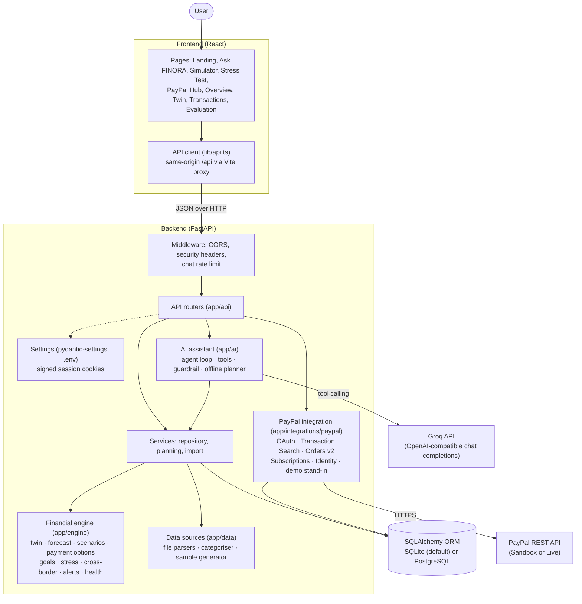
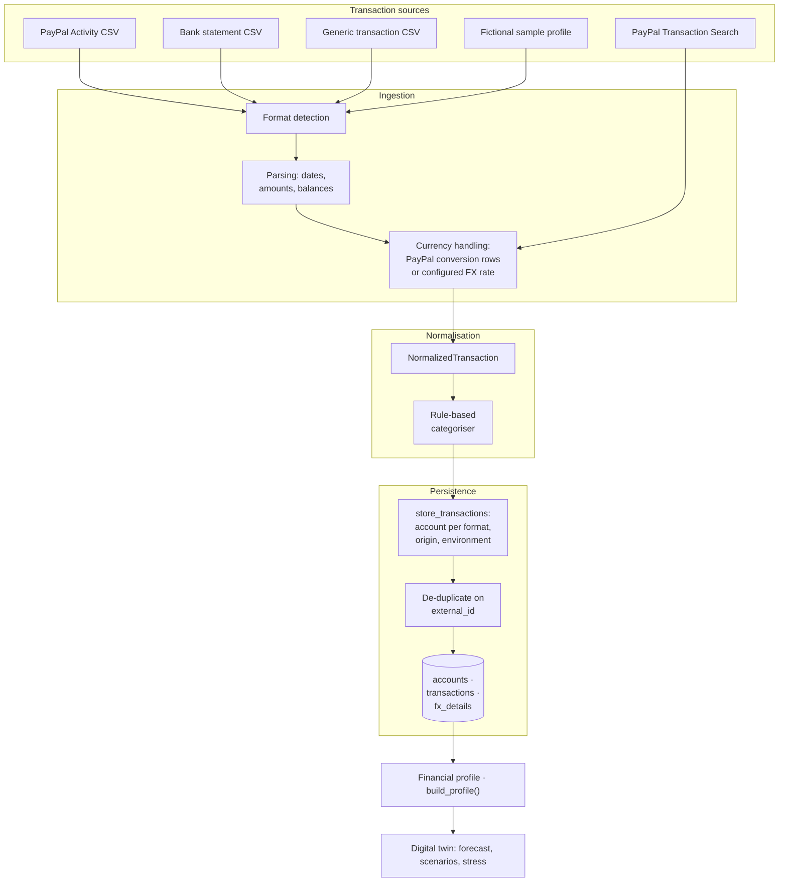
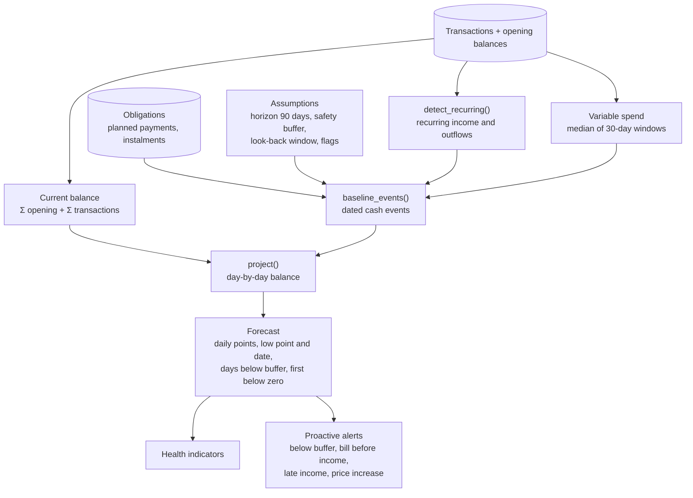
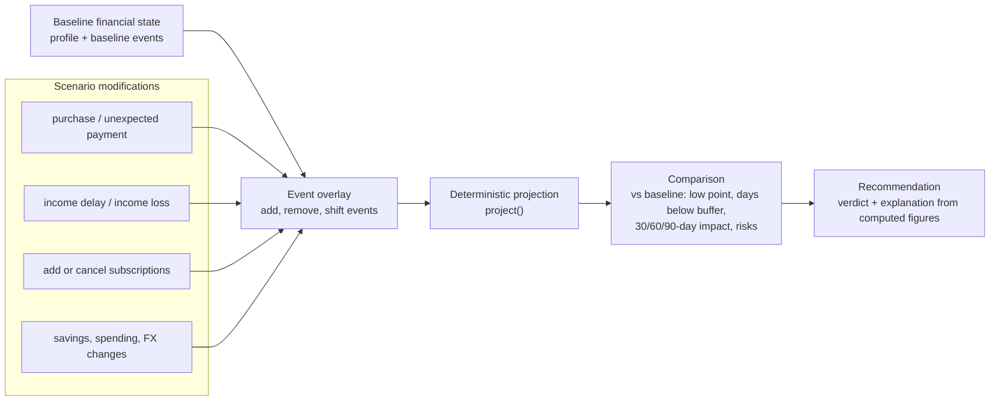
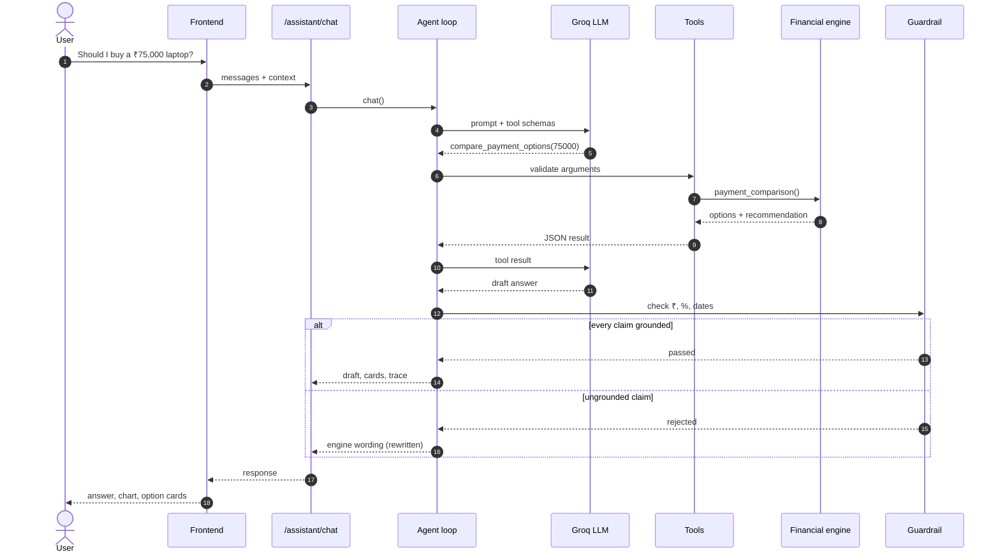
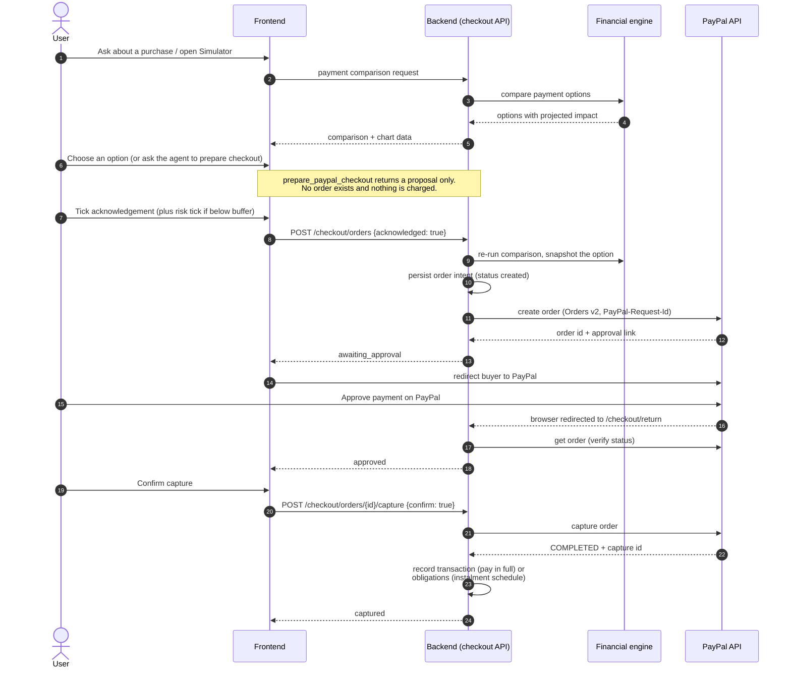
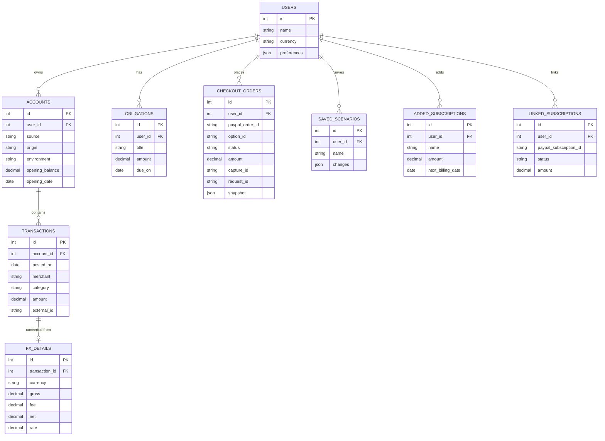
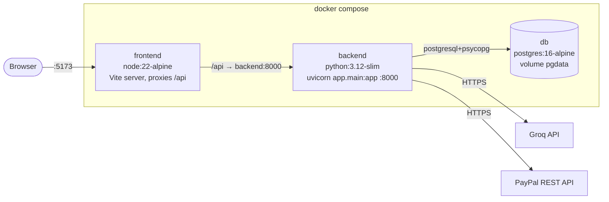

# FINORA Architecture

This document describes how FINORA is built: its components, how data moves through them, and the design decisions behind
them. For a product overview and setup instructions, see the [README](README.md).

## Contents
1. [System overview](#1-system-overview)
2. [High-level system architecture](#2-high-level-system-architecture)
3. [Financial data pipeline](#3-financial-data-pipeline)
4. [Financial digital twin and forecasting](#4-financial-digital-twin-and-forecasting)
5. [Scenario simulation engine](#5-scenario-simulation-engine)
6. [AI assistant architecture](#6-ai-assistant-architecture)
7. [PayPal integration and payment lifecycle](#7-paypal-integration-and-payment-lifecycle)
8. [Database architecture](#8-database-architecture)
9. [API layer](#9-api-layer)
10. [Deployment architecture](#10-deployment-architecture)
11. [Technology choices and design principles](#11-technology-choices-and-design-principles)

---

## 1. System overview

FINORA is a single-page React application backed by a FastAPI service. The backend has four layers with strict
responsibilities:

| Layer | Location | Responsibility |
|---|---|---|
| API | `backend/app/api/` | HTTP routing, request validation (Pydantic), confirmation gates, error mapping |
| Services | `backend/app/services/` | Load persisted data, convert it into engine inputs, persist imports |
| Engine | `backend/app/engine/` | All financial computation. Pure functions over Pydantic models: no database, network or LLM access |
| AI | `backend/app/ai/` | LLM client, tool definitions, agent loop, grounding guardrail, deterministic intent planner |

Two further packages connect FINORA to the outside world:

- `backend/app/data/` holds the SQLAlchemy models, file parsers (PayPal Activity, bank statement, generic transactions), the
  rule-based categoriser and the synthetic sample-profile generator.
- `backend/app/integrations/paypal/` holds the PayPal REST client (OAuth, Transaction Search, Orders v2, Subscriptions, Log in
  with PayPal) and an in-process stand-in used when no PayPal credentials are configured (*demo mode*).

The guiding rule is that **every financial figure is produced by the engine**. The AI layer decides *which* engine function to
call and phrases the result; it never produces authoritative numbers.

## 2. High-level system architecture

The frontend never calls Groq or PayPal directly and holds no credentials. All external calls originate from the backend.

## 3. Financial data pipeline

All transaction sources are normalised into one structure, `NormalizedTransaction` (`app/data/sources/base.py`), before they
reach storage or the engine. The engine never knows where a transaction came from.

Key behaviours:

- **Format detection** inspects CSV headers to choose between the PayPal Activity, bank statement and generic parsers.
  Opening balances are inferred from balance columns where present.
- **Currency:** multi-currency PayPal reports are converted using PayPal's own conversion rows, keeping the original amount,
  fee and applied rate (`fx_details`). Transaction Search records in a foreign currency are converted only at the configured
  `PAYPAL_CHECKOUT_FX_RATE`; records in other currencies are skipped and reported, never stored at face value.
- **Transfers:** PayPal deposits, withdrawals, transfers, adjustments and opening funding are categorised as `Transfer`,
  which the engine excludes from income and spending statistics.
- **Provenance:** every account records an `origin` (`sample`, `user_import`, `paypal_api`, `paypal_checkout`, `unknown`) and an
  `environment` (`sandbox`, `live`, `demo`). Sample and real data are not allowed to share a ledger: adding one while the other
  is loaded returns HTTP 409 unless the import replaces existing data.
- **Idempotency:** `transactions` has a unique constraint on `(account_id, external_id)`, and a PayPal transaction ID already
  stored in any PayPal-format account is skipped. Re-importing a file, or syncing an account that was previously uploaded as a
  CSV, never duplicates money. An import that would add no rows does not create an account (an empty account's opening
  balance would otherwise inflate the total).

## 4. Financial digital twin and forecasting

### Profile construction

`engine/twin.py::build_profile()` turns transactions, the current balance and obligations into a `FinancialProfile`:

| Signal | Rule (as implemented) |
|---|---|
| Recurring item | Same merchant and direction; ≥ 3 occurrences; median interval 25–35 days; at most one occurrence per calendar month in ≥ 80% of months; amount spread (max − min) / median ≤ 40%; last seen within 45 days. Projected amount = median of the last 3 occurrences |
| Recurring income | Recurring credits. Irregular income is excluded from forecasts by default |
| Variable spending | Non-recurring debits. Monthly rate per category = median of the last three 30-day windows, which is robust to one-off spikes |
| Savings | `Investments` (e.g. SIPs) count as savings, not spending |
| Health indicators | Savings rate, emergency runway, fixed-cost ratio, subscription load, lowest projected balance, each with explicit thresholds (`engine/health.py`) |

The profile can be adjusted without touching history: subscriptions added by hand or linked from PayPal are merged in, and
subscriptions marked as cancelled are removed (`with_added`, `without_cancelled`).

### Balances

Balances are derived, never stored: **balance = Σ account opening balances + Σ transactions**. Every displayed balance can be
traced back to individual transactions. Money is `Decimal` throughout. `core/money.py` raises an error if a `float` is passed,
and values are converted to JSON numbers only at the API boundary.

### Forecast generation

A forecast is a list of dated cash events: recurring income, recurring outflows, obligations and an estimated daily variable
spend. `project()` applies them day by day from today's balance. Every result carries its `Assumptions` (horizon, safety
buffer, look-back window, whether obligations and irregular income are included), so any figure can be reproduced from its
inputs. The default horizon is 90 days and the default safety buffer ₹20,000, both configurable.

## 5. Scenario simulation engine

Scenarios are **event overlays** on the baseline forecast. A scenario adds, removes or shifts cash events, and the same
`project()` function computes the result. A new kind of scenario therefore only needs to produce an overlay.

Supported changes (`engine/scenarios.py`): `purchase`, `add_subscription`, `cancel_subscriptions`, `income_delay` (optionally
for a single payer), `income_loss`, `increase_savings`, `expense_increase` (negative for cuts), `unexpected_payment` and
`fx_change`. Any combination can be stacked into one scenario, and up to four scenarios can be compared side by side.

Purchase decisions use three specialised engines built on the same projection:

- **Timing** (`engine/simulation.py`): today and each upcoming payday are simulated as purchase dates. Each date is evaluated
  over the full horizon *after* that date, so a late purchase cannot look safe merely because the window ended.
- **Payment strategies** (`engine/payment_options.py`): pay in full today, wait for a safe date, or split into instalments
  (Pay in 4, Pay Monthly). Each option produces its own balance series, low point, cost and safe flag. The recommendation is
  the cheapest option that keeps the balance above the safety buffer. Instalment terms (schedule, APR) are illustrative inputs:
  PayPal decides real Pay Later eligibility and terms at checkout.
- **Goal solver** (`engine/goals.py`): solves backwards for the maximum safe spend today, this month or within a window, and the
  earliest safe date for a given amount.

**Stress testing** (`engine/stress.py`) applies a shock library (job loss for one or three months, a 30% pay cut, a medical
emergency, living costs +30%, income 30 days late, and a currency drop for foreign income) and runs 400 seeded Monte Carlo
paths of day-to-day spending based on the user's own variability. It reports 10th/50th/90th-percentile balance bands, the
probability of falling below the buffer or zero, emergency runway, and a qualitative resilience label (strong, moderate,
fragile) derived from explicit thresholds. The seed is fixed, so identical data gives identical results.

**Cross-border income** (`engine/crossborder.py`) analyses foreign-currency income by client: PayPal fees, the rates PayPal
applied, conversion cost against a user-entered reference rate, sensitivity to exchange-rate moves, and the effect of a late
client payment.

## 6. AI assistant architecture

The assistant (`app/ai/assistant.py`) is an agent loop around the engine.

| Component | Role |
|---|---|
| `llm.py` | Groq client over its OpenAI-compatible Chat Completions API (any OpenAI-compatible endpoint is also supported). Retries 429/5xx with bounded backoff, retries `tool_use_failed` at temperature 0, and switches to the fallback model when the primary is unavailable or rate-limited |
| `tools.py` | Seven tools with JSON schemas: `get_financial_snapshot`, `compare_payment_options`, `find_affordability`, `simulate_scenario`, `run_stress_test`, `get_cross_border_summary`, `prepare_paypal_checkout`. Arguments are validated with Pydantic before the engine runs |
| `guardrail.py` | Checks every amount, percentage and date in a draft answer against the tool results and arguments the model received |
| `rules.py` | Deterministic intent planner that maps common questions (and follow-ups) to the same tools without an LLM |

Processing steps:

1. The system prompt, the last 12 conversation turns and the previous answer's `context` (its main tool call) are sent to the
   model. Follow-ups such as "and what if my salary is also late?" build on that context.
2. The model requests tools for up to 4 rounds and 8 tool calls. Each call runs against the engine, and the compact JSON result
   is returned to the model with the matching `tool_call_id`.
3. The model drafts an answer. The guardrail extracts its claims:
   - **Amounts** (₹, Rs, INR, lakh, K, crore) must match a tool figure, or ×12 / ÷12 of one, to the precision written:
     "₹1,68,391" to the rupee, "₹1.68 lakh" within ₹500, never more than 2%.
   - **Percentages** must be within 0.5 points of a tool figure or ratio.
   - **Dates** must appear in the tool results.
4. A draft that passes is returned. A draft that fails is replaced with the engine's own sentences for the same tool results,
   and the response is marked accordingly.
5. If the provider fails after retries and fallback, the deterministic planner answers with the same tools.

Every response includes a trace (model rounds, tool calls with arguments, guardrail result, token usage) that the UI shows
under *Technical details*.

The language model never calculates authoritative figures. It selects tools, supplies arguments, and phrases results; the
engine computes, and the guardrail enforces that the answer only states what the engine produced.

## 7. PayPal integration and payment lifecycle

### Integration modules

| Module | PayPal API | Use |
|---|---|---|
| `client.py` | OAuth 2.0 client credentials | Application token for server-to-server calls |
| `source.py` | Transaction Search (`/v1/reporting/transactions`), balances | Read-only sync in 31-day windows |
| `orders.py` | Orders v2 | Create, read and capture orders, with a `PayPal-Request-Id` idempotency key |
| `subscriptions.py` | Subscriptions v1 | Link and refresh subscriptions; cancel, suspend and activate require `confirm: true` |
| `identity.py` | Log in with PayPal (OpenID Connect) | Optional identity; no feature requires sign-in. Sessions use HMAC-signed cookies |
| `demo.py` | In-process stand-in | Serves the same endpoints through an httpx transport when no credentials are set and `PAYPAL_DEMO_MODE=true` |

`paypal_runtime()` selects the real API when credentials exist and the demo stand-in otherwise. The same client code runs in
both cases. Demo mode never contacts PayPal; its buyer pages are hosted by FINORA and labelled as a simulation.

### Payment lifecycle

Server-side gates, each returning an error if unmet:

| Step | Gate |
|---|---|
| Create order | `acknowledged: true` required (422) |
| Capture | Order must be `approved` (409); `confirm: true` required (422) |
| Repeat capture | An already captured order returns the existing capture; no second capture is attempted |
| Cross-currency checkout | Refused (400) unless `PAYPAL_CHECKOUT_FX_RATE` is set for the checkout currency |

Order intent is committed before PayPal is called, so failures are recorded rather than lost. On capture, a full payment is
written as a transaction in the `paypal_checkout` account for its environment, and an instalment plan as one dated obligation
per instalment (a simulated schedule from the illustrative terms). A matching "Planned:" obligation is removed so the purchase
is not counted twice. When the checkout currency differs from the profile currency (for example USD in Sandbox, INR profile),
PayPal is charged the converted amount (₹75,000 at a rate of 84 → USD 892.86) while the twin keeps the home-currency amount.

## 8. Database architecture

The schema is defined with SQLAlchemy 2 (`app/data/models.py`). Tables are created at startup with `create_all()`, and
`ensure_columns()` adds columns introduced after the first release to existing databases using standard `ALTER TABLE`
statements (covered by a test on SQLite). Money
columns are `NUMERIC(14,2)`.

A separate table, `demo_paypal_objects` (unique on `kind`, `key`), stores the state of the demo-mode PayPal stand-in (orders,
subscriptions); it is unused when real credentials are configured.

| Concern | Mechanism |
|---|---|
| Transaction identity | `external_id` from the source (PayPal transaction ID, capture ID, or a stable hash for CSV rows); unique per account |
| Idempotent imports | Unique `(account_id, external_id)`; cross-account skip for PayPal IDs |
| Idempotent PayPal calls | `request_id` on each order, sent as `PayPal-Request-Id` for create and capture |
| Audit of decisions | `checkout_orders.snapshot` stores the simulated option the user approved, the PayPal charge and what was recorded |
| Linked subscriptions | Unique `(user_id, paypal_subscription_id)` |

## 9. API layer

Routers live in `app/api/` and are mounted under `/api`. Interactive documentation is served by FastAPI at `/docs`.

| Router | Prefix | Purpose |
|---|---|---|
| `data.py` | `/status`, `/data/*`, `/demo-files`, `/demo-preview` | Status and provenance, file import, sample profile, landing preview |
| `dashboard.py` | `/dashboard`, `/twin`, `/forecast` | KPIs, health, history, forecast, profile |
| `transactions.py` | `/transactions`, `/obligations` | Paginated transactions with source filter; planned payments |
| `simulations.py` | `/simulations` | Purchase simulation, payment options, affordability, scenarios, comparison, saved scenarios |
| `stress.py` | `/stress` | Shock library and Monte Carlo |
| `crossborder.py` | `/crossborder` | Foreign income, fees, FX sensitivity |
| `alerts.py` | `/alerts` | Proactive alerts and dismissal |
| `assistant.py` | `/assistant` | Agent status and chat (rate-limited per client) |
| `paypal.py` | `/integrations/paypal` | Integration overview, authentication check, Transaction Search sync |
| `checkout.py` | `/checkout` | Orders v2 checkout, PayPal return/cancel, capture, planned purchases |
| `subscriptions.py` | `/subscriptions` | Detected, added and PayPal-linked subscriptions and their actions |
| `auth.py` | `/auth` | Optional Log in with PayPal |
| `paypal_demo.py` | `/paypal-demo` | Buyer-side pages of demo mode (404 when real credentials are set) |
| `settings.py` | `/settings` | Name and safety buffer |
| `evals.py` | `/evals` | Committed evaluation results (read-only) |

A request is validated by Pydantic schemas (`app/schemas/api.py`), handled by a router, which calls the services layer for
data access and the engine for computation, and responds with engine models serialised to JSON. Engine functions never receive
database sessions. Every response passes through middleware that adds security headers (`X-Content-Type-Options`,
`X-Frame-Options`, `Referrer-Policy`, `Cache-Control: no-store`).

## 10. Deployment architecture

- **Local development:** the backend runs with uvicorn on port 8000 using SQLite (`sqlite:///./finora.db`); the Vite dev server
  on port 5173 proxies `/api` to it (`VITE_API_PROXY_TARGET`). The frontend contains no backend URL or secrets.
- **Docker Compose:** PostgreSQL 16 with a health check, the backend (with `DATABASE_URL` pointing at the `db` service and an
  optional `.env`), and the frontend container running the Vite server with the proxy pointed at the backend. The backend image
  copies only `app/`, so committed evaluation results (`evals/results`) are not available in the container's Evaluation page.
- **Configuration** (`.env` at the repository root or in `backend/`; environment variables take precedence):

| Variable | Purpose |
|---|---|
| `DATABASE_URL` | SQLite by default; `postgresql+psycopg://...` for PostgreSQL |
| `CORS_ORIGINS`, `FRONTEND_URL` | Allowed origins; public app URL used for PayPal return links |
| `SESSION_SECRET`, `SESSION_MAX_AGE_DAYS` | Signing key and lifetime for Log in with PayPal sessions |
| `GROQ_API_KEY`, `GROQ_MODEL`, `GROQ_FALLBACK_MODEL`, `LLM_PROVIDER` | AI provider; without a key the deterministic planner answers |
| `OPENAI_API_KEY`, `OPENAI_MODEL`, `OPENAI_BASE_URL` | Optional alternative OpenAI-compatible provider |
| `CHAT_RATE_LIMIT_PER_MINUTE` | Per-client chat limit (in-process) |
| `PAYPAL_CLIENT_ID`, `PAYPAL_CLIENT_SECRET`, `PAYPAL_BASE_URL` | PayPal REST credentials (Sandbox URL by default) |
| `PAYPAL_CHECKOUT_CURRENCY`, `PAYPAL_CHECKOUT_FX_RATE` | Checkout currency and the user-configured conversion rate |
| `PAYPAL_DEMO_MODE` | Use the built-in stand-in when no credentials are set (default `true`) |
| `DEMO_SEED`, `FORECAST_HORIZON_DAYS`, `DEFAULT_SAFETY_BUFFER` | Sample generator seed and forecast defaults |

## 11. Technology choices and design principles

**Deterministic financial engine.** All calculations are pure functions with no randomness, so identical inputs give identical
outputs. The only stochastic component, the stress test's Monte Carlo, uses a fixed seed for the same reason. Results can be reproduced, tested and audited,
which an LLM cannot guarantee.

**Decimal monetary precision.** Money is `Decimal` from parsing to response; `money()` refuses floats; database columns are
`NUMERIC(14,2)`. Rounding errors cannot accumulate across a 90-day projection or a sum of hundreds of transactions.

**Separation of AI and calculation.** The AI layer can only call engine tools and phrase their output. The guardrail rejects
claims that the tools did not produce, and the deterministic planner covers the main questions without any model. The system
therefore keeps working, with the same figures, when the provider is unavailable.

**Replaceable transaction sources.** Every source produces `NormalizedTransaction`. Adding a source (another bank format, an
aggregator) does not touch the engine, and provenance is recorded at storage time rather than inferred later.

**Scenario event overlays.** Forecasts are lists of dated events, and scenarios modify those events. One projection function
serves the baseline, every what-if, timing analysis, payment strategies and stress shocks, so their results are directly
comparable.

**Backend-controlled payment execution.** Payment steps are enforced by the checkout API, not by the AI or the browser. The
agent's most powerful action is a proposal; creating an order needs acknowledgement, and capture needs PayPal approval and an
explicit confirmation. Credentials never leave the server.

**Reproducible assumptions.** Each forecast and simulation returns the assumptions it used. Each checkout stores a snapshot
of the simulation the user approved. The sample profile is generated relative to the current date with a fixed seed, and
recurring bills are anchored to the pay cycle so its shape is the same on any date (verified by a test across a full year).
